# Chest X-ray analysis: classical image processing + machine learning

An end-to-end pipeline that takes a frontal chest X-ray and predicts **Normal vs Abnormal** (lung opacity / viral pneumonia).
Every stage uses a technique from the image-processing syllabus (enhancement, noise models, restoration, segmentation,
morphology, feature extraction), and the final stage compares the classical-feature approach with a deep-learning baseline.
A Streamlit dashboard runs the whole chain interactively.

> **Research prototype for a coursework project. Not a medical device and not clinically validated. Do not use for diagnosis.**

**Author:** `Jahnavi Kashyap & Khushi Singh`  |  **Course / institution:** `<Image Processing and Analysis, KIIT>`  |  **Final report:** [`reports/final_report.pdf`](reports/final_report.pdf)

---

## Contents
1. [Pipeline](#pipeline) 2. [Dashboard screenshots](#dashboard-screenshots) 3. [Results at a glance](#results-at-a-glance)
4. [Repository layout](#repository-layout) 5. [Setup](#setup) 6. [Data](#data) 7. [Reproducing the results](#reproducing-the-results)
8. [Using the dashboard](#using-the-dashboard) 9. [Limitations](#limitations) 10. [Tests](#tests) 11. [Citation and licence](#citation-and-licence)

---

## Pipeline

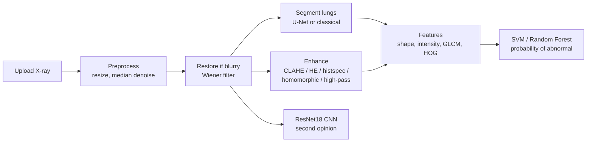

| Stage | Methods | Syllabus unit |
|---|---|---|
| Dataset study | class balance, image sizes, noise estimate, duplicate / leakage check | - |
| Noise handling | Gaussian, salt-and-pepper, speckle, Poisson models; median / Gaussian / bilateral / NLM benchmark | IV |
| Enhancement | HE, CLAHE, histogram specification (spatial) vs homomorphic and Butterworth high-pass (frequency) | II, III |
| Restoration | inverse, truncated inverse, Wiener, constrained least squares on simulated blur + noise; Wiener applied to blurry real images | IV |
| Segmentation | Otsu, multi-Otsu, adaptive threshold, k-means, region growing, morphology, shape-prior atlas, U-Net | VI |
| Features | 27 shape, 10 intensity-statistics, 14 GLCM, 324 HOG = **375 per image** | VII |
| Classification | SVM (RBF), Random Forest, ResNet18 transfer learning | - |

---

## Dashboard screenshots

Run the app with `streamlit run app/streamlit_app.py` (see [Using the dashboard](#using-the-dashboard)).
Screenshots below use one **Normal** and one **Abnormal** test-set image. Put your images in `docs/screenshots/` using the file names shown.

### 1. Overview (upload, lung outline, verdict, second opinion)
| Normal | Abnormal |
|---|---|
| 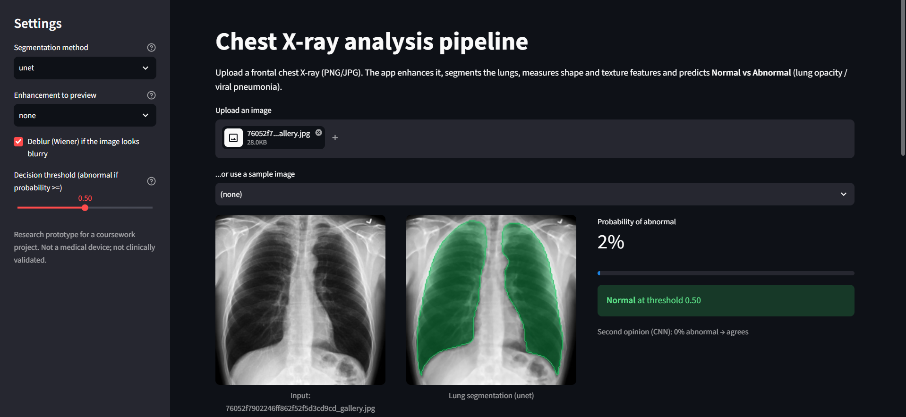 | 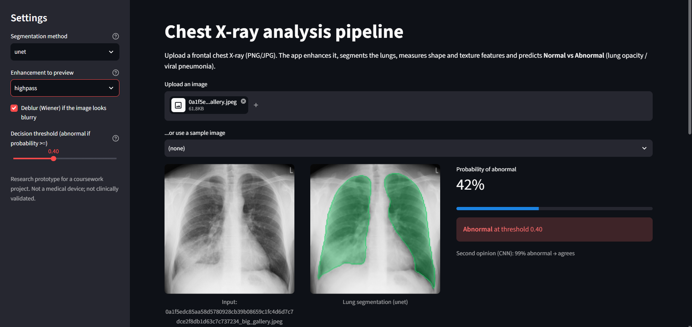 |

### 2. Preprocessing (resize, denoise, optional deblur)
| Normal | Abnormal |
|---|---|
| 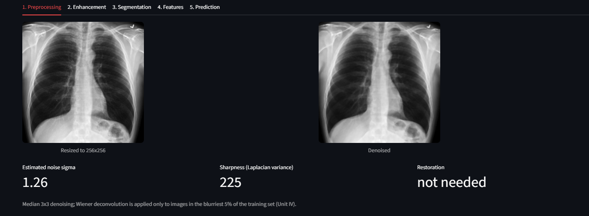 | 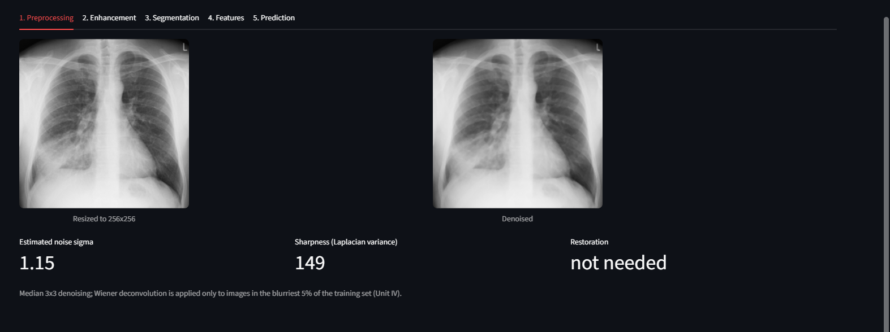 |

### 3. Enhancement comparison (spatial vs frequency domain)
Before/after images with histograms for each method.

| Method | Normal | Abnormal |
|---|---|---|
| Histogram equalisation | 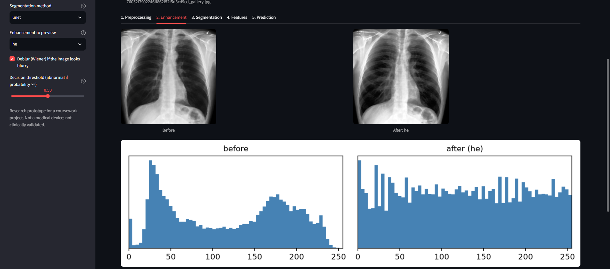 | 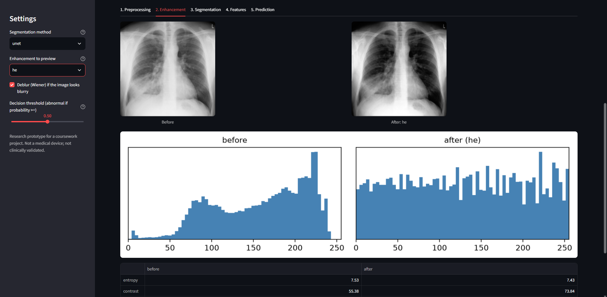 |
| CLAHE | 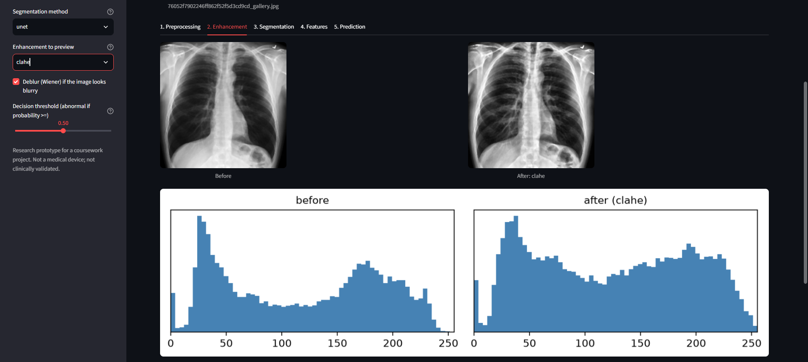 | 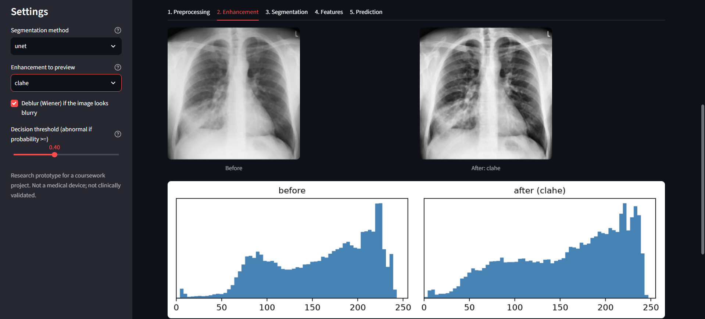 |
| None | 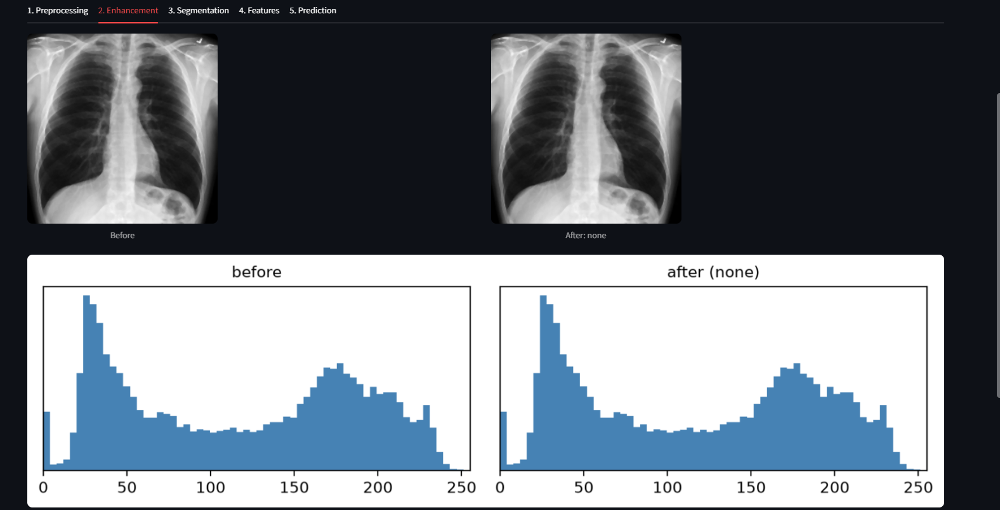 | 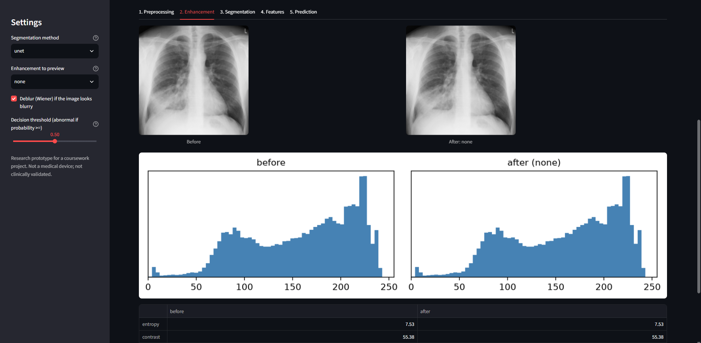 |
| Homomorphic filter | 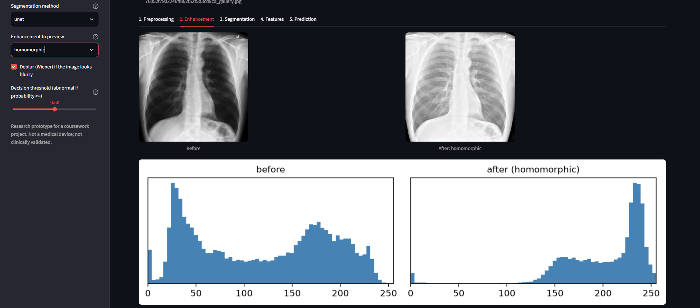 | 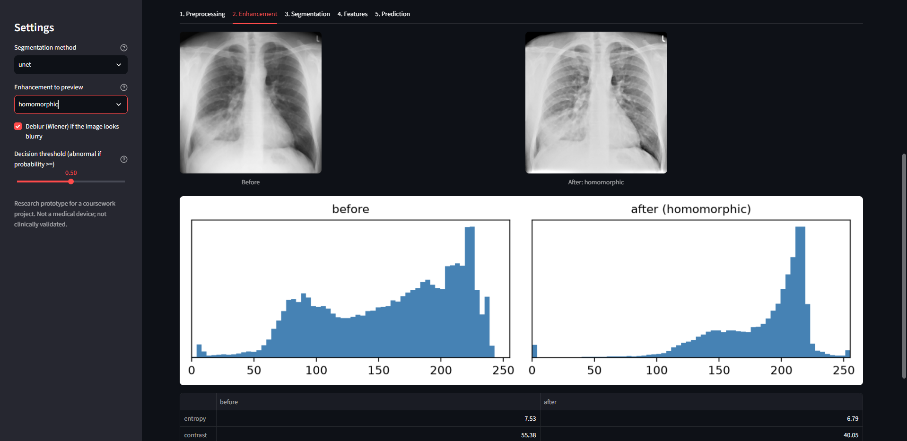 |
| Butterworth high-pass | 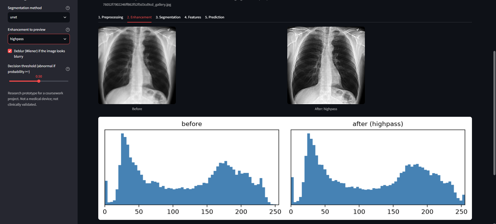 | 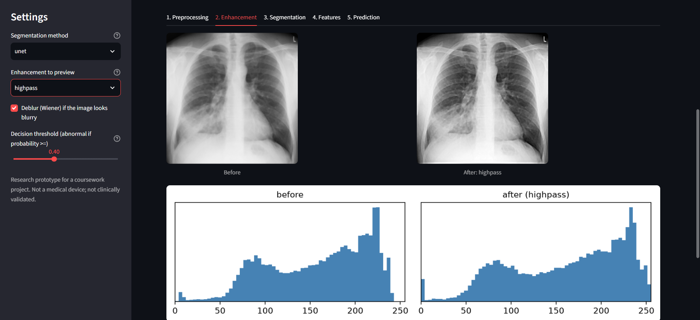 |

### 4. Segmentation comparison (U-Net vs classical methods)
The "Compare all segmentation methods" panel on the Segmentation tab.

| Normal | Abnormal |
|---|---|
| 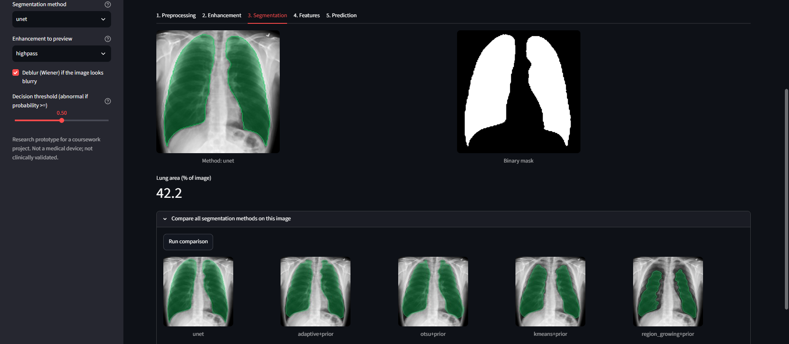 | 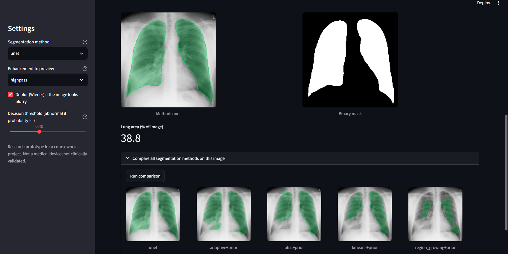 |

### 5. Features (shape, intensity, GLCM, and comparison with typical training images)
| Normal | Abnormal |
|---|---|
| 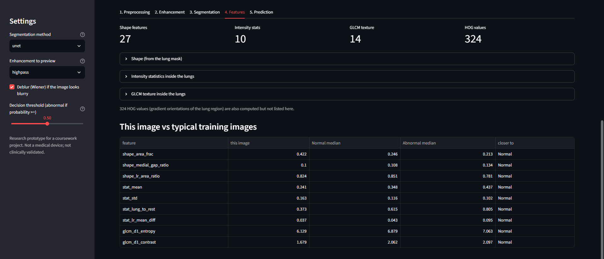 | 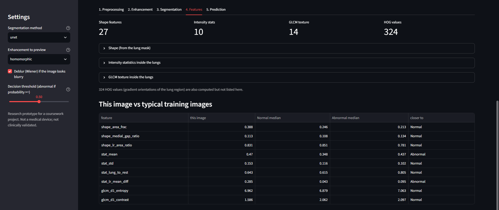 |

### 6. Prediction (feature-based model, CNN second opinion, threshold trade-off)
| Normal | Abnormal |
|---|---|
| 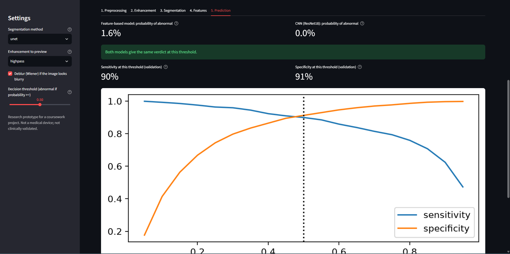 | 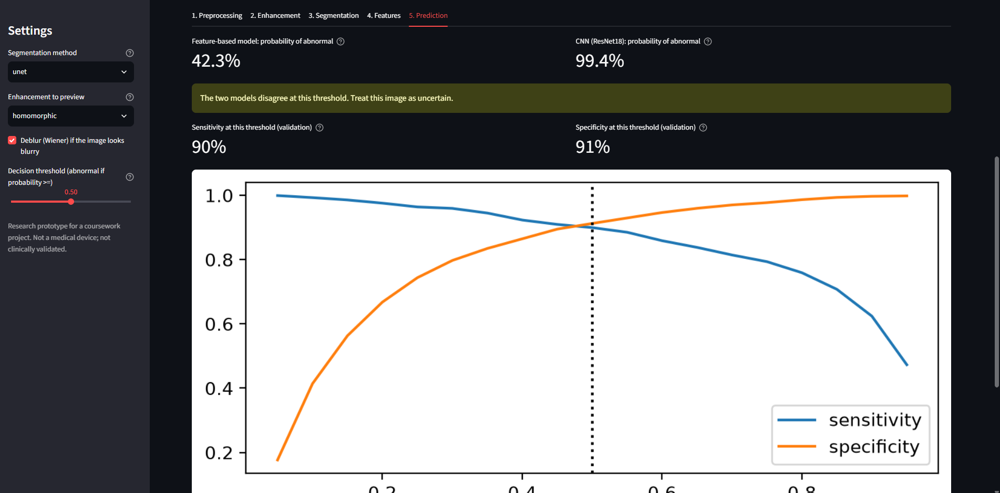 |

### Batch sample outputs
Produced by `python scripts/run_pipeline_demo.py --n 2 --copy-samples` (illustrations from the test split, **not an evaluation**):
see [`reports/sample_outputs/`](reports/sample_outputs/).

---

## Results at a glance

All model-selection numbers are on the **validation** split (2,633 images; 95% bootstrap CIs are about +-1.2 points for accuracy).
The test split is evaluated once, for the final models only.

### Dataset and protocol
COVID-19 Radiography Database: 17,549 images in the binary task (Normal = 0; Lung_Opacity and Viral Pneumonia = 1), with ground-truth lung masks.
Stratified split 70 / 15 / 15 (12,283 / 2,633 / 2,633), fixed seed. Hyper-parameters are tuned with 3-fold CV on the train split only.

### Enhancement (Part 1): lung/background separability on 90 train images
| none | HE | CLAHE | hist. spec. | high-pass | homomorphic |
|---|---|---|---|---|---|
| 0.581 | 0.803 | 0.691 | **0.945** | 0.579 | 0.303 |

### Segmentation (Part 3): mean Dice on validation (150 images per class)
| Method | Dice |
|---|---|
| Atlas only (average lung shape, **no image used**) | 0.708 |
| Best plain classical method (adaptive threshold on histogram-specified image) | 0.617 |
| Best classical method with shape prior (adaptive + prior, no enhancement) | 0.756 |
| **U-Net (128 px, trained on the train split)** | **0.980** (Normal 0.987, Lung_Opacity 0.976, Viral Pneumonia 0.976) |

Classical thresholding falls below the atlas baseline without a prior: paediatric films, portable films with tubes and consolidated lungs break intensity-based methods.

### Classification (Part 5): ablation (validation)
| Config | Segmentation | Features | Model | Accuracy | F1 | AUC |
|---|---|---|---|---|---|---|
| A | none (whole image) | stat + GLCM + HOG | RF | 0.866 | 0.831 | 0.936 |
| A2 | U-Net | stat + GLCM + HOG | RF | 0.893 | 0.872 | 0.951 |
| B / C / D | U-Net | shape / intensity / GLCM only | RF | 0.851 / 0.843 / 0.752 | 0.822 / 0.813 / 0.715 | 0.916 / 0.914 / 0.834 |
| E | U-Net | HOG only | RF | 0.874 | 0.847 | 0.940 |
| F | U-Net | shape + stat + GLCM (51 features) | RF | 0.884 | 0.861 | 0.947 |
| G | U-Net | all 375 | RF | 0.902 | 0.883 | 0.957 |
| G | U-Net | all 375 | **SVM** (PCA 100) | **0.911** | **0.893** | **0.967** |
| I | ground-truth masks | all 375 | RF | 0.903 | 0.883 | 0.958 |
| H / K / L / M / N | U-Net | all 375, enhancement = CLAHE / HE / hist. spec. / homomorphic / high-pass | RF | 0.899 / 0.896 / 0.898 / 0.896 / 0.898 | 0.879 / 0.873 / 0.875 / 0.873 / 0.877 | 0.955 / 0.956 / 0.951 / 0.953 / 0.955 |
| J | none (end-to-end) | learned | **ResNet18** | **0.940** | **0.925** | **0.982** |

Findings:
- **Segmentation helps** the feature-based classifier by about 3 accuracy points (A vs A2, identical features).
- **U-Net masks are as good as ground-truth masks** for classification (0.902 vs 0.903).
- **Enhancement does not help the classifiers**: all six variants are within noise, and spatial and frequency methods tie. (It did matter for classical segmentation.)
- **The CNN is the most accurate**, mainly through fewer false alarms (specificity 0.980 vs 0.929); its recall (0.885) equals the SVM's (0.886).
- **Shortcut check:** removing the paediatric-looking Viral Pneumonia class (Normal vs Lung_Opacity only) gives the same result (accuracy 0.904, AUC 0.960), so that class is not driving the scores.

### Final test-set results (run once)
| Model | Accuracy | F1 | AUC | Recall | Specificity |
|---|---|---|---|---|---|
| SVM on features (U-Net masks) | 0.927 | 0.914 | 0.973 | 0.921 | 0.932 |
| ResNet18 CNN | 0.953 | 0.943 | 0.985 | 0.919 | 0.978 |

---

## Repository layout
```
config.yaml               paths, image size, seeds, enhancement / restoration parameters
app/streamlit_app.py      the dashboard;   app/samples/  sample images for the dashboard
src/
  io_utils.py             config, dataset index + stratified splits, image I/O
  preprocessing.py  noise_models.py  enhancement.py  restoration.py  dedup.py  pipeline.py
  segmentation/           classical.py (5 methods), postprocess.py, atlas.py, unet.py, unet_data.py
  features/               shape.py, glcm.py (+ intensity stats), hog_features.py, build_table.py
  classifiers/            classical_ml.py, experiment.py, cnn.py
  evaluation/             metrics.py (Dice, IoU, PSNR, SSIM, bootstrap CIs), ablation.py, compare.py, plots.py, seg_eval.py
scripts/                  one script per stage (see "Reproducing the results")
notebooks/02_enhancement_comparison.ipynb   Part 1 before/after report
reports/                  figures, CSV tables, ablation_table.csv, sample_outputs/
docs/screenshots/         dashboard screenshots used in this README
tests/                    69 tests (metrics, enhancement, segmentation on synthetic phantoms, features, classifiers, pipeline, app)
data/  models/            NOT in git (see below)
```

---

## Setup
```bash
python -m venv .venv
source .venv/bin/activate            # Windows PowerShell: .venv\Scripts\Activate.ps1
pip install -r requirements.txt
pytest -q tests
```
Python 3.10 to 3.12 recommended. PyTorch is needed for the U-Net and CNN (CPU is enough for inference; train on a GPU, e.g. Google Colab).

## Data
Download the **COVID-19 Radiography Database** from Kaggle (`tawsifurrahman/covid19-radiography-database`) and unzip it so that you have
`data/raw/COVID-19_Radiography_Dataset/{Normal,Lung_Opacity,"Viral Pneumonia",COVID}/{images,masks}/`.
Adjust `paths.raw_root` in `config.yaml` if your folder differs. `data/` and the model weights are excluded from git.

**Trained models:** not stored in the repository because of size. Re-create them with the steps below, or download them from
`https://drive.google.com/drive/folders/1E1PYuEof1ofJqmuGxwAAWqAvkh7hGGjh?usp=sharing` and place them in `models/` (`unet_none.pt`, `classifier.joblib`, `lung_atlas.npy`, `cnn_none.pt`).

---

## Reproducing the results
Commands in the order they were run. Run from the repository root with the virtual environment active.

**Part 1 and 2: dataset study, preprocessing, restoration**
```bash
python scripts/run_eda.py                              # class counts, sizes, noise; writes splits.csv
python scripts/check_duplicates.py                     # leakage check; use --fix only after inspecting the figure
python scripts/run_restoration_experiment.py --n 20    # simulated blur/noise: inverse vs Wiener vs CLS
python scripts/run_restoration_apply.py                # audit real images, deblur the blurriest 5%
python scripts/run_preprocessing.py --restore --methods clahe he histspec homomorphic highpass
python scripts/run_enhancement_comparison.py --n 30    # tables; then open notebooks/02_enhancement_comparison.ipynb
```

**Part 3: segmentation**
```bash
python scripts/build_atlas.py                          # mean lung mask of the train split + atlas-only Dice baseline
python scripts/run_segmentation.py --n 150             # classical methods, plain and with shape prior
# U-Net: train on a GPU (Google Colab), then evaluate and export masks locally
python scripts/export_unet_data.py --enh none --size 128      # -> data/colab_bundle/ (upload to Drive)
#   Colab:  python scripts/train_unet.py --data unet_none_128.npz --epochs 20 --batch 32
python scripts/run_segmentation.py --n 150 --enh none --unet models/unet_none.pt
python scripts/run_segmentation.py --write none unet          # masks for all images -> data/predicted_masks/none_unet/
```

**Part 4: features** (375 per image; about a minute per variant on a multi-core CPU)
```bash
python scripts/run_feature_extraction.py --enh none --masks none_unet
python scripts/analyze_features.py --file data/features/features_none__none_unet.csv
# ablation variants
python scripts/run_feature_extraction.py --enh none --masks gt           # oracle masks
python scripts/run_feature_extraction.py --enh none --masks full         # no segmentation
python scripts/run_feature_extraction.py --enh clahe --masks none_unet   # likewise he, histspec, homomorphic, highpass
```

**Part 5: classifiers and ablation**
```bash
python scripts/run_ablation.py --models rf                                         # whole grid -> reports/ablation_table.csv
python scripts/run_ablation.py --models svm --only G A2 --svm-pca 100 --n-iter 8 --tune-n 3000
python scripts/train_classifier.py --name G_noViral --model rf --drop-class "Viral Pneumonia"   # shortcut check
# CNN baseline on Colab
python scripts/export_cnn_data.py --enh none --size 128
#   Colab:  python scripts/train_cnn.py --data cnn_none_128.npz --epochs 10
python scripts/run_ablation.py --cnn reports/cnn_none_128.json --cnn-name J_cnn_none
```

**Final evaluation: run each exactly once, after all choices are made**
```bash
python scripts/train_classifier.py --name FINAL --enh none --masks none_unet --groups shape stat glcm hog --model svm --svm-pca 100 --n-iter 8 --tune-n 3000 --final --save
#   Colab:  python scripts/train_cnn.py --data cnn_none_128.npz --eval-only models/cnn_none.pt
python scripts/run_ablation.py --cnn reports/cnn_none_128.json --cnn-name J_cnn_none
```

**Part 6: demo**
```bash
python scripts/run_pipeline_demo.py --n 2 --copy-samples     # sample outputs + dashboard sample images
streamlit run app/streamlit_app.py
```

---

## Using the dashboard
`streamlit run app/streamlit_app.py` opens http://localhost:8501. Upload a PNG/JPG chest X-ray or pick a sample, then:

1. **Preprocessing:** resize to 256 px, median denoise; Wiener deblur only if the image is in the blurriest 5% of the training set.
2. **Enhancement:** preview any method with before/after histograms (features always use the enhancement the classifier was trained on).
3. **Segmentation:** U-Net (default) or a classical method; a button compares all methods on the current image.
4. **Features:** shape, intensity and GLCM values, and how this image compares with typical Normal / Abnormal training images.
5. **Prediction:** probability from the feature-based model, a CNN second opinion with an agree/disagree message, and a **decision-threshold slider** showing the sensitivity/specificity trade-off measured on the validation set.

If a model file is missing the app degrades gracefully (classical segmentation instead of the U-Net, no CNN panel) and says so in the sidebar.

---

## Limitations
- **One public dataset, binary task.** Classes come from different source collections, so source-specific differences (scanner, contrast, patient age) may inflate scores; the Normal vs Lung_Opacity check reduces but does not remove this concern.
- **No patient IDs.** Near-duplicate images were detected and handled, but the same patient may still appear in more than one split.
- **Ground-truth masks are not radiologist annotations**, as far as I know they were produced semi-automatically, so Dice 0.98 measures agreement with those masks.
- Validation numbers guided model choices; only the final test numbers (once available above) are unbiased estimates.
- **Operating point.** At the default threshold about 11-12% of abnormal cases are missed; the dashboard threshold slider shows the trade-off for the feature-based model only.
- Frontal chest X-rays only; photographs, screenshots or other modalities will give unreliable results. **Not for clinical use.**

## Tests
`pytest -q tests` runs 69 tests: metric correctness, enhancement and restoration properties, segmentation on synthetic phantoms (including lungs that touch the image border), feature invariants (e.g. GLCM ignores pixels outside the mask), the leakage check, classifier protocol, the analysis pipeline, and the dashboard (headless Streamlit runner).

## Citation and licence
- Dataset: M.E.H. Chowdhury et al., "Can AI help in screening Viral and COVID-19 pneumonia?", *IEEE Access*, 2020; and T. Rahman et al., "Exploring the effect of image enhancement techniques on COVID-19 detection using chest X-ray images", *Computers in Biology and Medicine*, 2021. Please confirm the exact citation and licence terms on the dataset's Kaggle page (the dataset is distributed under a non-commercial Creative Commons licence).
- Code: add a `LICENSE` file (for example MIT) if others may reuse it. Sample images in `app/samples/` come from the dataset and keep its licence.
